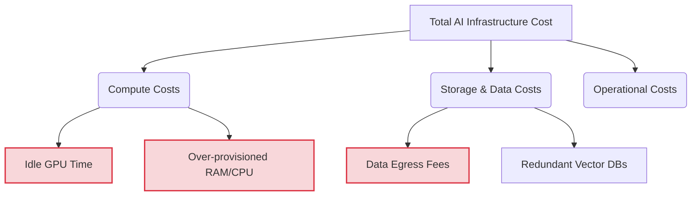
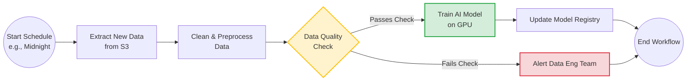
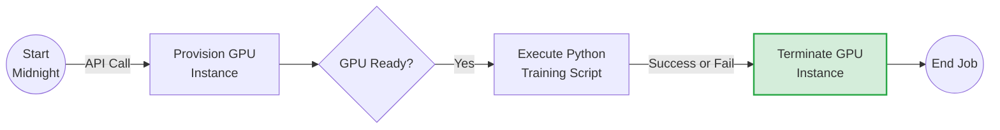

# Cost Optimisation and Resource Management

**Session Time:** 120 minutes

---

## Table of Contents
1.  Identifying Cost Drivers in AI Infrastructure Management
2. Applying Monitoring and Automation Techniques
3. Evaluating the Balance Between Performance, Scalability, and Cost Efficiency
4. Lab: Workflow Automation Lab
5. Wrap-Up and Reflection

---

## Learning Objectives

By the end of this module, participants will be able to:

1. Identify cost drivers in AI infrastructure management.
2. Apply monitoring and automation techniques to reduce unnecessary spend.
3. Evaluate the balance between performance, scalability, and cost efficiency.

---

## Session Breakdown

| Segment | Topic                                                             | Duration (minutes) |
|---------|-------------------------------------------------------------------|--------------------|
| 1       | Identifying Cost Drivers in AI Infrastructure Management          | 20                 |
| 2       | Applying Monitoring and Automation Techniques                     | 20                 |
| 3       | Evaluating the Balance Between Performance, Scalability, and Cost | 20                 |
| 4       | Lab: Workflow Automation Lab                                      | 60                 |

---

## 1.  Identifying Cost Drivers in AI Infrastructure Management

To effectively optimise resource allocation and cloud costs without sacrificing performance, you must first understand where the budget is going. AI systems typically incur costs that are vastly different from traditional web applications. 

### Core Cost Drivers in AI
* **Idle Compute (GPUs/TPUs):** 
  
  AI accelerators are expensive. Leaving a GPU instance running 24/7 when inferences only happen during business hours is a primary source of wasted budget.

* **Data Egress and Transfer:**
  
  Moving large datasets across cloud regions or extracting them for local analysis incurs heavy networking fees.

* **Over-provisioning:** 
  
  Requesting massive memory or CPU allocations for a container "just in case" rather than profiling the actual resource needs.


### Tools Used: Python
You can use Python to profile your AI application's actual resource consumption locally. By logging memory and CPU usage during a model's inference cycle, you can identify if your cloud instances are over-provisioned.

### Practical Example
Before deploying to the cloud, you can run a simple Python script using the `psutil` library to benchmark the memory footprint of loading your AI model. If the script shows the model only consumes 4GB of RAM, you know that provisioning a 16GB instance is a major, unnecessary cost driver.

```python
import psutil
import time

def profile_model_loading():
    print(f"Baseline RAM: {psutil.virtual_memory().used / (1024**3):.2f} GB")
    
    # Simulate loading a large AI model
    print("Loading AI Model into memory...")
    dummy_model_weights = bytearray(4 * 1024 * 1024 * 1024) # 4GB
    time.sleep(2)
    
    peak_ram = psutil.virtual_memory().used / (1024**3)
    print(f"Peak RAM after load: {peak_ram:.2f} GB")
    print("Action: Do not provision instances larger than necessary for this footprint.")

profile_model_loading()
```
<br/><br/>



---

## 2. Applying Monitoring and Automation Techniques

Once you identify the cost drivers, you must apply monitoring and automation techniques to reduce unnecessary spend. Automation ensures that infrastructure is treated ephemerally—it exists only when work needs to be done.

### Concepts: Event-Driven Automation
Instead of keeping a server running continuously to wait for a daily batch of data, an event-driven workflow spins up the resources, executes the AI model training or batch inference, and immediately tears the resources down. 

### What is Apache Airflow?

**Apache Airflow** is an open-source platform used to programmatically author, schedule, and monitor workflows. Instead of manually running scripts or relying on basic cron jobs, Airflow allows you to define complex data pipelines as code (specifically, using Python). 

In AI systems operations, Airflow is heavily used for workflow automation and managing data pipelines efficiently. For example, you can use it to automatically spin up a heavy GPU instance at midnight, train your AI model on the latest data, save the results, and immediately spin the GPU back down to save costs.

#### The Core Concept: The DAG

In Airflow, a workflow is defined as a **DAG** (Directed Acyclic Graph). 
* **Directed:** 
  
  The tasks flow in a specific direction (e.g., Task A must happen before Task B).

* **Acyclic:** 
  
  The workflow does not loop back on itself; it has a clear start and end.

* **Graph:** 
  
  A visual representation of the tasks and their dependencies.


---

### Visualizing an Airflow DAG

Here is an example of what an automated AI training pipeline looks like when mapped out as an Airflow DAG. 



#### How it Works:
1. **Dependencies:** 
   
   The `Train AI Model` task cannot start until the `Data Quality Check` successfully passes. If the data check fails, the graph branches off to alert the team instead.

2. **Resilience:** 
   
   If the `Clean & Preprocess Data` task fails due to a temporary network glitch, Airflow can be configured to automatically retry that specific task without having to restart the entire workflow from the beginning.

3. **Observability:** 
   
   Airflow provides a web interface where you can visually track the progress of this DAG, seeing exactly which tasks succeeded (usually highlighted in green) and which failed (highlighted in red).


### Tools Used: Apache Airflow (local) and Python
**Apache Airflow** allows you to build lightweight, event-driven workflows. You define the pipeline as a Directed Acyclic Graph (DAG) using **Python**, ensuring that tasks run in the correct order and compute resources are released the second the job is finished.

### Practical Example
Here is how you use Airflow to automate a cost-saving lifecycle. This Python DAG ensures a costly GPU instance is only active for the exact duration of the training job.

```python
from airflow import DAG
from airflow.operators.bash import BashOperator
from datetime import datetime

with DAG('cost_optimised_ai_training', start_date=datetime(2024, 1, 1), schedule_interval='@daily') as dag:
    
    # Step 1: Spin up the expensive GPU instance
    start_gpu = BashOperator(
        task_id='provision_gpu_instance',
        bash_command='echo "Provisioning AWS EC2 p3.2xlarge..."'
    )
    
    # Step 2: Run the training script
    train_model = BashOperator(
        task_id='run_model_training',
        bash_command='python /scripts/train.py'
    )
    
    # Step 3: Crucial Cost Saving - Terminate the instance immediately
    terminate_gpu = BashOperator(
        task_id='terminate_gpu_instance',
        bash_command='echo "Terminating instance to stop billing."',
        trigger_rule='all_done' # Runs even if training fails, preventing infinite billing
    )
    
    start_gpu >> train_model >> terminate_gpu
```
<br/><br/>



---

## 3. Evaluating the Balance Between Performance, Scalability, and Cost Efficiency

The role of an AI Systems Engineer is to constantly evaluate the balance between performance, scalability, and cost efficiency. Pushing too hard for cost savings can ruin the user experience (e.g., waiting 5 minutes for a cold-started model to reply), while maximizing performance will quickly deplete the operational budget.

### Concepts: The Trade-Off Triangle
* **Cost vs. Performance:** Opting to use a quantized, smaller AI model instead of a massive one. It is cheaper and faster, but slightly less accurate.
* **Cost vs. Scalability:** Deciding whether to use Spot Instances (highly discounted but can be interrupted at any time) versus On-Demand instances (expensive but reliable).

### Tools Used: Python (Data Analysis)
You can use Python to simulate and evaluate these trade-offs mathematically before committing to an architectural decision. 

### Practical Example
If you are deciding between keeping 5 servers running 24/7 (high performance/high cost) versus an Airflow-managed auto-scaling approach (balanced), you can write a Python calculation to evaluate the financial impact.


---

## 4. Lab: Workflow Automation Lab

**Objective:** Build a lightweight, event-driven workflow using Apache Airflow. This lab reinforces automation principles for managing data pipelines efficiently.

*(Please refer to the lab platform for complete instructions, starter code, and access to the Apache Airflow environment).*

---

## 5. Wrap-Up and Reflection

**Reflection Questions:**
1. How does using Apache Airflow to create an event-driven data pipeline directly impact your monthly cloud infrastructure bill?
2. When evaluating the balance between performance and cost efficiency, in what scenarios would it be unacceptable to use cheaper, interruptible Spot Instances for your AI workloads?

## 6. Resources

* **Workflow Automation:** [Apache Airflow Official Documentation](https://airflow.apache.org/docs/apache-airflow/stable/index.html) - A comprehensive guide to authoring, scheduling, and monitoring Python-based DAGs.
* **Cloud Cost Management:** [FinOps Foundation](https://www.finops.org/introduction/what-is-finops/) - Frameworks and best practices for managing and optimizing cloud infrastructure costs.
* **Local Profiling:** [psutil Documentation](https://psutil.readthedocs.io/en/latest/) - Learn how to use this cross-platform Python library to retrieve information on running processes and system utilization (CPU, memory, disks, network).
* **AI Resource Efficiency:** [Architecting for Scale with AWS Machine Learning](https://aws.amazon.com/machine-learning/) - Industry standards on right-sizing instances and managing data pipelines efficiently.