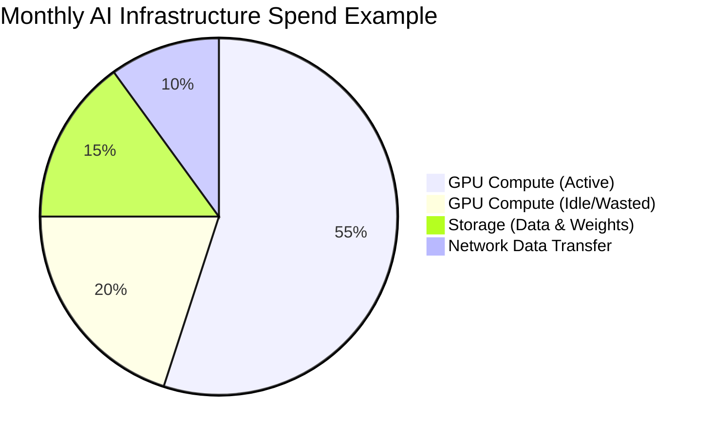
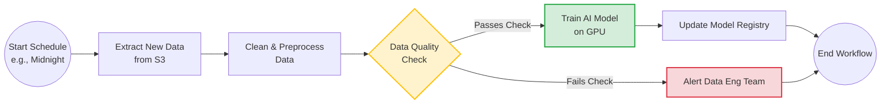
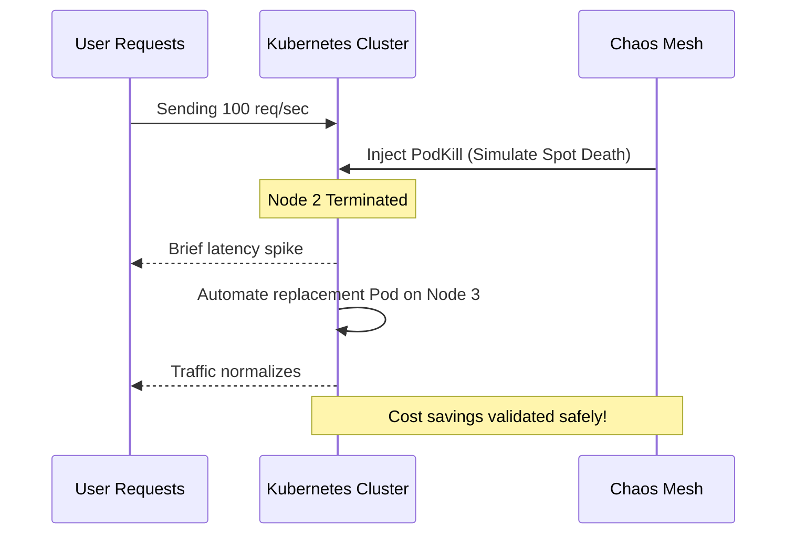
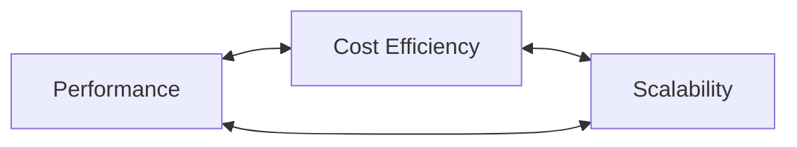

# COST OPTIMISATION AND RESOURCE MANAGEMENT

**Session Time:** 120 minutes

---

## Table of Contents
1. Identifying Cost Drivers in AI Infrastructure Management
2. Applying Monitoring and Automation Techniques to Reduce Spend
3. Evaluating the Balance Between Performance, Scalability, and Cost Efficiency
4. Lab: Workflow Automation Lab
5. Wrap-Up and Reflection

---

## Module Overview
Analyse how to optimise resource allocation and cloud costs without sacrificing performance. Learn to monitor usage patterns and apply automation for efficiency.

## Session Breakdown

| Segment | Topic                                          | Duration (minutes) |
|---------|------------------------------------------------|--------------------|
| 1       | Identifying AI Cost Drivers                    | 20                 |
| 2       | Monitoring and Automating Resource Usage       | 20                 |
| 3       | Trade-offs: Cost, Scalability, and Performance | 20                 |
| 4       | Lab: Workflow Automation Lab                   | 60                 |

---

## 1. Identifying Cost Drivers in AI Infrastructure Management

Before you can reduce spending, you must identify where the budget is going. AI workloads have unique resource profiles compared to traditional software, primarily due to the massive scale of data and specialized hardware required.

### Key Cost Drivers in AI:
* **Compute (GPUs/TPUs):** 
  
  The most significant expense. Idle GPUs waiting for data or running unoptimized batches drain budgets rapidly.
  
* **Storage:** 
  
  Storing terabytes of training data and managing multiple versions of large model weights (e.g., 40GB+ per LLM).

* **Network Egress:** 
  
  Moving massive datasets between cloud providers or out to edge devices.


### Tools Used: Minikube
We use **Minikube** to simulate a cloud environment locally. By defining strict resource limits (CPU/Memory) on our local Minikube pods, we can identify the absolute minimum resources an AI model needs to run before it crashes, helping us avoid over-provisioning expensive cloud instances.

### Practical Example
If an AI text-to-speech model only requires 2GB of RAM and 1 CPU core to achieve acceptable latency, but is deployed on a cloud instance with 16GB of RAM and 8 cores, you are paying for 14GB of wasted memory. Using Minikube, you can benchmark the model locally to find these exact boundaries before spending cloud credits.



### Tools Used: Apache Airflow

**Apache Airflow** is an open-source platform used to programmatically author, schedule, and monitor workflows. Instead of manually running scripts or relying on basic cron jobs, Airflow allows you to define complex data pipelines as code (specifically, using Python). 

In AI systems operations, Airflow is heavily used for workflow automation and managing data pipelines efficiently. For example, you can use it to automatically spin up a heavy GPU instance at midnight, train your AI model on the latest data, save the results, and immediately spin the GPU back down to save costs.

#### The Core Concept: The DAG

In Airflow, a workflow is defined as a **DAG** (Directed Acyclic Graph). 
* **Directed:** 
  
  The tasks flow in a specific direction (e.g., Task A must happen before Task B).

* **Acyclic:**
  
  The workflow does not loop back on itself; it has a clear start and end.
* **Graph:** 
  
  A visual representation of the tasks and their dependencies.


### Visualizing an Airflow DAG

Here is an example of what an automated AI training pipeline looks like when mapped out as an Airflow DAG. 



#### How it Works:
1. **Dependencies:** The `Train AI Model` task cannot start until the `Data Quality Check` successfully passes. If the data check fails, the graph branches off to alert the team instead.
2. **Resilience:** If the `Clean & Preprocess Data` task fails due to a temporary network glitch, Airflow can be configured to automatically retry that specific task without having to restart the entire workflow from the beginning.
3. **Observability:** Airflow provides a web interface where you can visually track the progress of this DAG, seeing exactly which tasks succeeded (usually highlighted in green) and which failed (highlighted in red).

### Example of Airflow DAG in Python

One of the best features of Apache Airflow is that workflows are configured entirely in Python. This means your data pipelines can be version-controlled, tested, and reviewed just like any other software code.

> When you are first building a lightweight workflow to manage your data pipelines efficiently, you only really need three core ingredients: the **DAG** (the container), the **Tasks** (the actual work), and the **Dependencies** (the order they run in).

```python
from airflow import DAG
from airflow.operators.bash import BashOperator
from datetime import datetime

# 1. The Container: Create the DAG and tell it when to run
with DAG(
    dag_id='simple_ai_pipeline',
    start_date=datetime(2024, 1, 1),
    schedule_interval='@daily'
) as dag:

    # 2. The Tasks: Define what actually needs to happen
    get_data = BashOperator(
        task_id='download_data',
        bash_command='echo "Downloading training data..."'
    )

    train_model = BashOperator(
        task_id='train_model',
        bash_command='echo "Training the AI model..."'
    )

    # 3. The Order: Use the >> symbol to draw the arrow
    get_data >> train_model
```

### Concepts Explained:
* **Simple Commands:** Instead of triggering complex Python scripts, this uses basic `echo` commands in a `BashOperator` so you can test it immediately on your local machine and watch the logs output the text.
* **Clear Flow:** `get_data >> train_model` is the exact equivalent of drawing a literal arrow from the first step to the second. The AI model will never attempt to train until the data is successfully downloaded.

---

## 2. Applying Monitoring and Automation Techniques to Reduce Spend

Once cost drivers are identified, manual intervention is not enough. You must apply monitoring and automation techniques to reduce unnecessary spend. This involves configuring systems to scale down (or off completely) when demand is low.

### The Spot Instance Strategy
One of the most effective ways to reduce AI compute costs by up to 80% is using **Spot Instances** (spare cloud capacity sold at a discount). However, the cloud provider can terminate these instances with almost no warning. Your system must be automated to handle these sudden losses gracefully.

### Tools Used: Chaos Mesh (local)
**Chaos Mesh** is a cloud-native Chaos Engineering platform. We use it to purposefully inject failures into our system to ensure our automation works. If we want to use cheap Spot Instances, we must prove our cluster can survive sudden node terminations.

### Practical Example
You configure your AI API to run on a cluster of cheap, preemptible nodes. You use Chaos Mesh to run a "PodKill" experiment, randomly destroying AI worker pods every 5 minutes. 

```yaml
# chaos-mesh-podkill.yaml
apiVersion: chaos-mesh.org/v1alpha1
kind: PodChaos
metadata:
  name: simulate-spot-instance-termination
spec:
  action: pod-kill
  mode: one
  selector:
    labelSelectors:
      app: ai-inference-worker
  scheduler:
    cron: "@every 5m"
```

If your Kubernetes automation successfully detects the dead pods and spins up replacements on new cheap nodes without dropping user requests, you have successfully validated a highly cost-optimized architecture.



---

## 3. Evaluating the Balance Between Performance, Scalability, and Cost Efficiency

Optimization is always a compromise. You must evaluate the balance between performance, scalability, and cost efficiency. Reducing costs too much leads to unacceptable latency, which drives users away.

### The Optimization Triangle
1. **Performance:** 
   
   How fast the AI generates a response.

2. **Cost Efficiency:** 
   
   How cheaply the response is generated.

3. **Scalability:** 
   
   How well the system handles 10x the traffic.



### Tools Used: Chaos Mesh & Minikube combined
You can use Minikube to limit the resources of a pod (Cost Efficiency) and use Chaos Mesh to inject Network Delay (Performance impact). This helps you answer the question: *"If we use a cheaper, slower storage tier, how badly does it affect the user experience?"*

### Practical Example
You are deciding whether to store your AI model weights on expensive, ultra-fast SSDs or cheaper standard HDDs. 
You use Chaos Mesh to inject a 200ms network latency to simulate the slower HDD read speeds. 
You observe that the AI model's total response time goes from 1.0s to 1.2s. You determine that a 1.2s response time is still perfectly acceptable for your users, allowing you to choose the cheaper storage option and save thousands of dollars a month without sacrificing meaningful performance.

---

## 4. Lab: Workflow Automation Lab

**Objective:** Build a lightweight, event-driven workflow using Apache Airflow. This lab reinforces automation principles for managing data pipelines efficiently, ensuring compute resources are only utilized when data is actively ready to be processed.

*(Please refer to the lab platform for complete instructions, starter code, and access to the workflow environment).*

---

## 5. Wrap-Up and Reflection

**Reflection Questions:**
1. How does using Chaos Mesh to simulate node failure directly enable a team to comfortably use heavily discounted Spot Instances for AI workloads?
2. If an AI system autoscales perfectly but takes 5 minutes to pull the 40GB model weights into memory on a new node, how does this impact the balance of cost and performance?
3. What is the financial danger of relying solely on vertical scaling (buying bigger GPUs) instead of optimizing your model architecture?